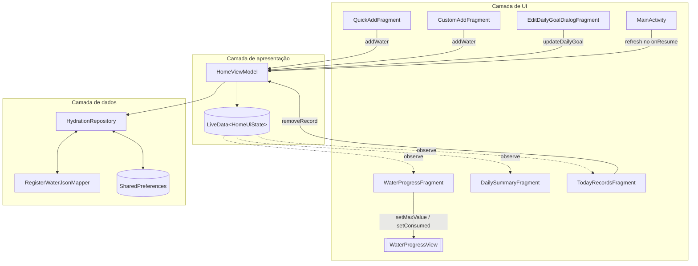
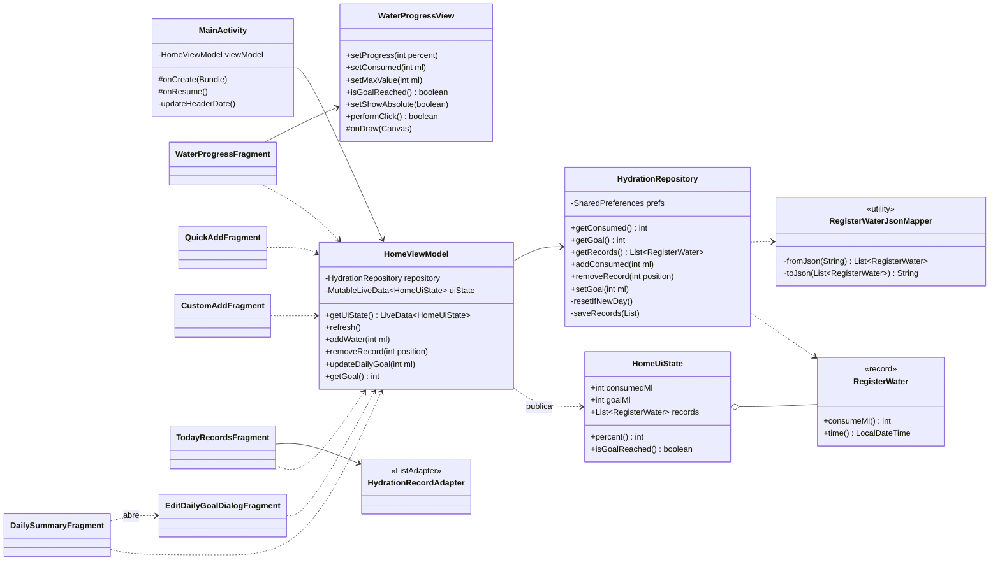
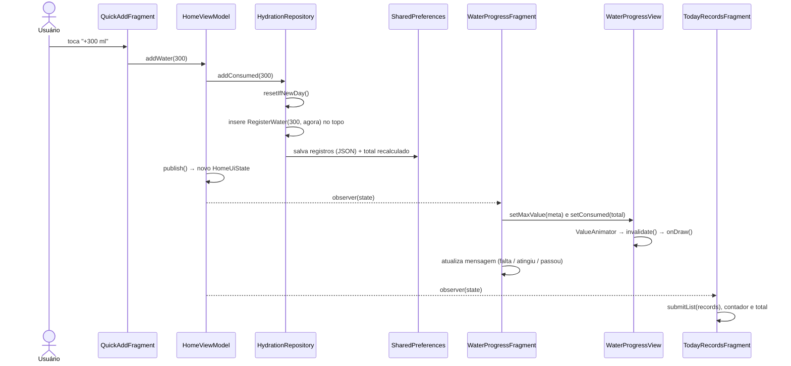
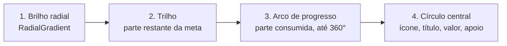
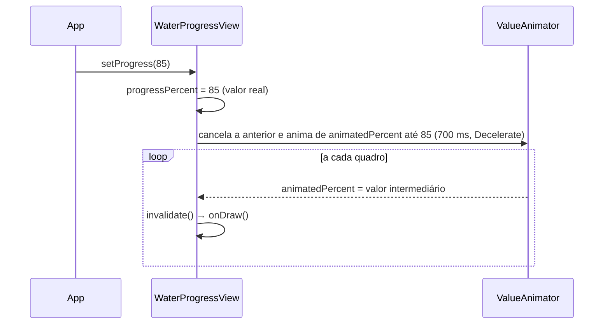
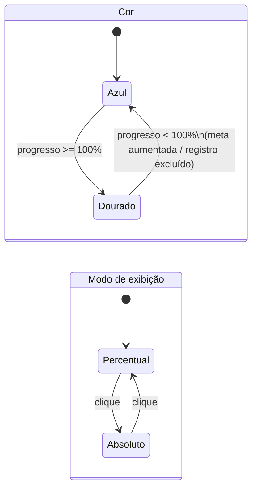
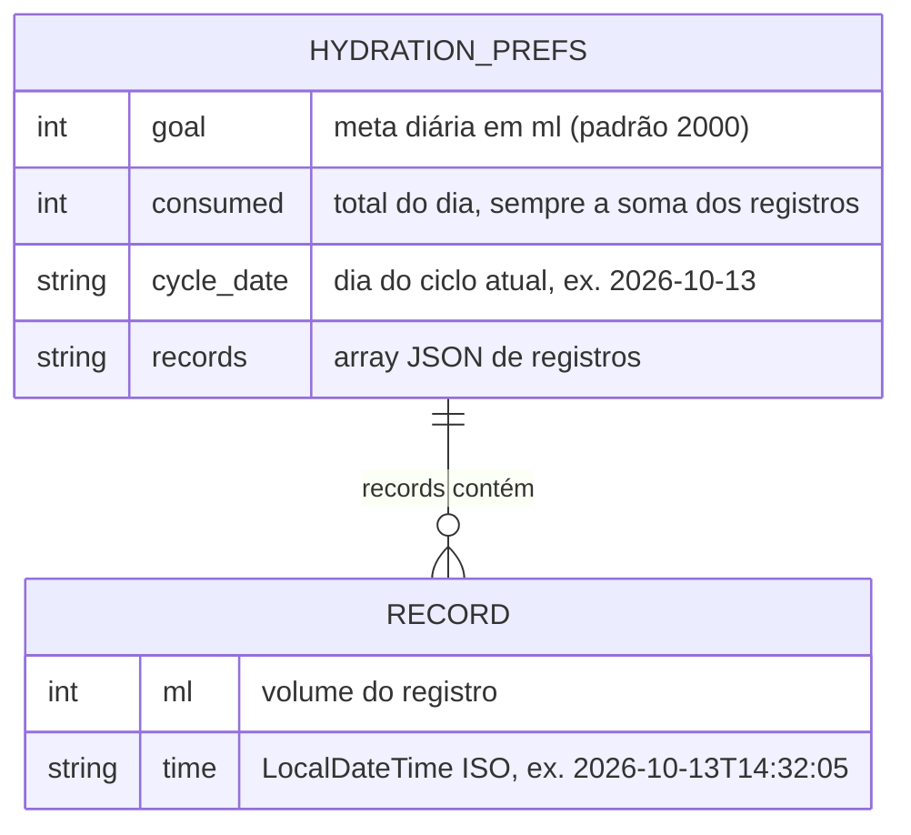
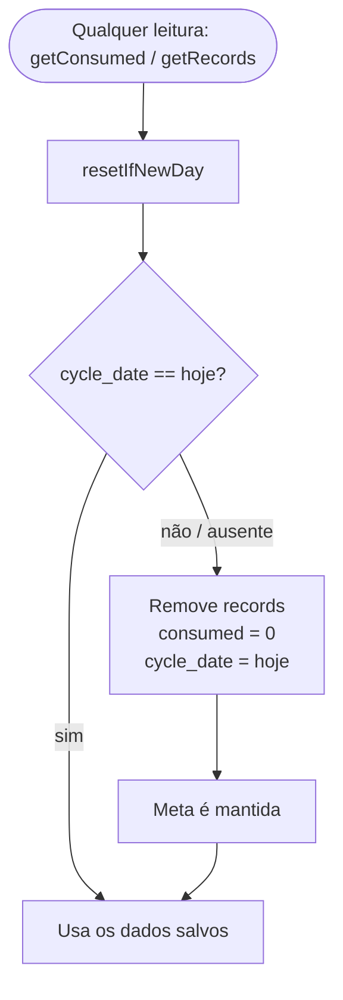
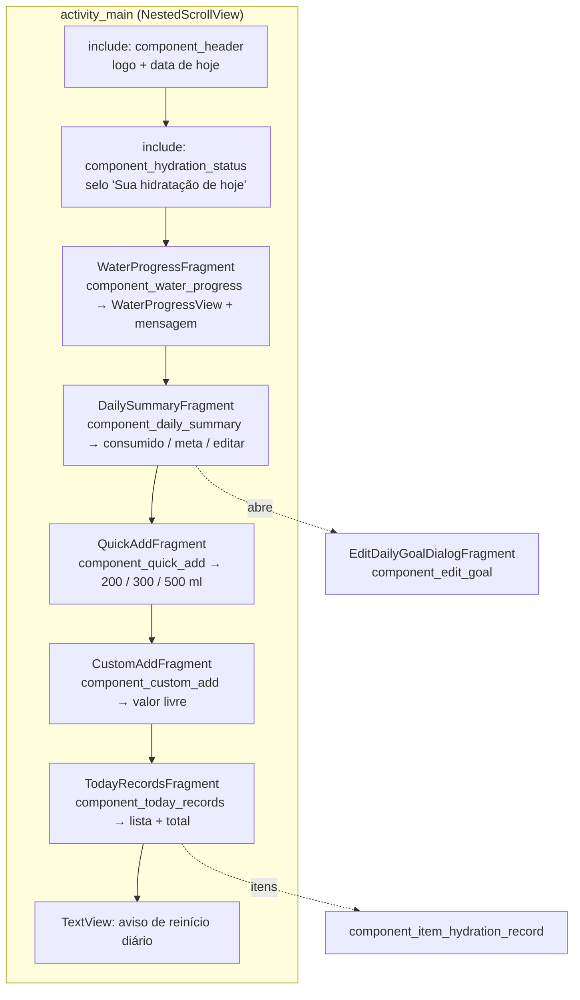

# HydroTrack

Aplicativo Android, em **Java**, para acompanhar o consumo diário de água. O usuário define uma meta diária e registra o que bebe ao longo do dia. O progresso aparece num componente gráfico próprio, a `WaterProgressView`, desenhado com `Canvas`. Os dados ficam salvos e são reiniciados a cada novo dia.

> 🎬 **Vídeo do app em funcionamento:** https://photos.app.goo.gl/bJRkp9WKZ5j8E61E9

| Item | Valor |
|---|---|
| Linguagem | Java 21 |
| minSdk / targetSdk | 28 / 37 |
| UI | XML + ViewBinding + Fragments |
| Arquitetura | MVVM (ViewModel + LiveData + Repository) |
| Persistência | SharedPreferences (registros em JSON) |

---

## Sumário

1. [Funcionalidades](#funcionalidades)
2. [Estrutura de pastas](#estrutura-de-pastas)
3. [Arquitetura](#arquitetura)
4. [Diagrama de classes](#diagrama-de-classes)
5. [Fluxo de dados](#fluxo-de-dados)
6. [WaterProgressView](#waterprogressview)
7. [Persistência e ciclo diário](#persistência-e-ciclo-diário)
8. [Composição da tela](#composição-da-tela)
9. [Padrões do projeto](#padrões-do-projeto)
10. [Como executar](#como-executar)

---

## Funcionalidades

- Definir e alterar a meta diária. A alteração mantém os registros do dia.
- Registrar o consumo com atalhos (200, 300 e 500 ml) ou com um valor digitado.
- Ver cada registro com volume e horário, ver o total do dia e excluir registros.
- Acompanhar o progresso na `WaterProgressView`, com animação suave.
- Tocar no gráfico para alternar entre **percentual** (`68%`) e **absoluto** (`1360/2000 ml`).
- Alerta visual em **dourado** quando a meta é atingida ou ultrapassada; os textos mostram o total acumulado (ex.: `115%`).
- Dados persistidos: tudo volta ao reabrir o app.
- Reinício automático a cada novo dia, com base na data do sistema.

---

## Estrutura de pastas

```text
app/src/main/
├── java/com/reynanfc/hydrotrack/
│   ├── MainActivity.java                 # Activity única: hospeda os fragments, atualiza data e ciclo no onResume
│   ├── data/local/
│   │   ├── HydrationRepository.java      # Fonte de dados: meta, registros, total e ciclo diário
│   │   └── RegisterWaterJsonMapper.java  # Converte List<RegisterWater> <-> JSON
│   ├── model/
│   │   ├── RegisterWater.java            # record: volume (ml) + instante
│   │   └── HomeUiState.java              # Estado imutável da tela (consumo, meta, registros)
│   └── ui/
│       ├── home/
│       │   ├── HomeViewModel.java        # Expõe o estado via LiveData e recebe as ações da UI
│       │   ├── components/               # Um Fragment por bloco da tela
│       │   │   ├── WaterProgressFragment.java
│       │   │   ├── DailySummaryFragment.java
│       │   │   ├── EditDailyGoalDialogFragment.java
│       │   │   ├── QuickAddFragment.java
│       │   │   ├── CustomAddFragment.java
│       │   │   ├── TodayRecordsFragment.java
│       │   │   └── HydrationRecordAdapter.java
│       │   └── utils/
│       │       ├── HomeDateFormatter.java  # "Hoje, 13 de outubro"
│       │       └── VolumeFormatter.java    # 2500 -> "2.500"
│       └── widget/
│           └── WaterProgressView.java    # Componente gráfico customizado (Canvas), reutilizável
└── res/
    ├── layout/          # activity_main + component_* (um layout por componente)
    ├── drawable/        # background_*, ic_*, selector_*
    ├── color/           # selectors de cor (selector_*)
    └── values/
        ├── attrs.xml    # Atributos da WaterProgressView
        ├── colors.xml   # Paleta hydro_* (tela clara) + paleta escura do card de registros
        ├── strings.xml  # Todos os textos da interface
        └── dimens.xml
```

---

## Arquitetura

O app segue **MVVM** com fluxo de dados **unidirecional**. As ações saem da UI para o ViewModel, que chama o Repository. O Repository persiste os dados, e o ViewModel publica um novo `HomeUiState`, que todos os fragments observam.



**Por que separar assim?**

| Camada | Responsabilidade | Não faz |
|---|---|---|
| Fragments | Ligam o layout (ViewBinding), repassam cliques e renderizam o estado | Regras de negócio ou acesso a dados |
| `WaterProgressView` | Desenhar e animar o progresso | Saber de onde vêm os dados (é reutilizável) |
| `HomeViewModel` | Centralizar ações e publicar o estado da tela | Acessar `View`s |
| `HydrationRepository` | Persistir, recalcular o total e controlar o ciclo do dia | Formatar texto para a tela |
| `RegisterWaterJsonMapper` | Serializar registros | Saber onde os registros são salvos |

Todos os fragments obtêm o **mesmo** `HomeViewModel` com `new ViewModelProvider(requireActivity())`. Por isso, uma ação em um componente atualiza todos os outros.

---

## Diagrama de classes



---

## Fluxo de dados

### Registrar um consumo



### Alterar a meta

`DailySummaryFragment` abre o `EditDailyGoalDialogFragment`. Ao salvar, ele chama `updateDailyGoal(ml)`, o repository grava a nova meta, e o novo estado faz a `WaterProgressView` recalcular o percentual. Os registros do dia **não** são alterados. Se a nova meta ficar acima do consumo, o alerta dourado some automaticamente.

---

## WaterProgressView

Componente em `ui/widget/`, independente do resto do app. Pode ser colocado em qualquer layout.

### Camadas do desenho (`onDraw`)



- **Geometria** (raios, espessuras, tamanhos de fonte) é calculada em `onSizeChanged`, sempre como proporção do tamanho da view. Assim, ela se adapta a qualquer `layout_width` / `layout_height`, e o `onDraw` não cria objetos a cada quadro.
- **O arco** começa em `-90°` (topo) e cresce no sentido horário: `sweep = min(percent, 100) / 100 × 360`.
- **Texto principal** reduz a fonte automaticamente se não couber no círculo (`fitTextSize`).

### Animação



O alerta usa `progressPercent`, o valor real recebido, e **não** o valor animado. Ou seja, ele reflete os dados salvos, não um efeito visual temporário.

### Estados visuais e interação



| Modo | Texto principal | Texto de apoio |
|---|---|---|
| Percentual | `68%` | `1360 de 2000 ml` |
| Absoluto | `1360/2000 ml` | `68% da meta` |

O modo atual é salvo em `onSaveInstanceState`, por isso a view precisa de `android:id`.

### API pública

| Método | Descrição |
|---|---|
| `setProgress(int percent)` | Atualiza o progresso em percentual (pode passar de 100), com animação |
| `setConsumed(int ml)` | Atalho: calcula o percentual a partir da meta e mantém o valor exato em ml |
| `setMaxValue(int ml)` | Altera a meta em tempo de execução |
| `isGoalReached()` | `true` quando o progresso é maior ou igual a 100% |
| `setShowAbsolute(boolean)` | Define o modo de exibição |
| `setProgressColor`, `setTextColor`, `setAlertColor` | Cores em tempo de execução |

### Atributos XML (`res/values/attrs.xml`)

```xml
<com.reynanfc.hydrotrack.ui.widget.WaterProgressView
    android:id="@+id/water_progress_view"
    android:layout_width="200dp"
    android:layout_height="200dp"
    app:progressColor="#2196F3"
    app:textColor="#000000"
    app:alertColor="#D4A017"
    app:maxValue="2000" />
```

| Atributo | Formato | Padrão |
|---|---|---|
| `progressColor` | color | `@color/hydro_primary` |
| `textColor` | color | `@color/hydro_card_foreground` |
| `alertColor` | color | `@color/hydro_goal_reached` |
| `maxValue` | integer (ml) | `2000` |

Os atributos são lidos no construtor com `TypedArray` (`obtainStyledAttributes` + `recycle`).

---

## Persistência e ciclo diário

### Mecanismo escolhido: SharedPreferences

Os dados são pequenos: uma meta, um total e uma lista curta de registros do dia. Também só existe uma "tabela" lógica, sem consultas ou relacionamentos. O `SharedPreferences` resolve isso sem dependências extras, gravando de forma assíncrona (`apply()`). Os registros são guardados como um array JSON numa única chave. Se o app precisasse de histórico de vários dias ou de consultas, a escolha natural seria migrar para **Room/SQLite**.

### Modelo dos dados salvos

Arquivo de preferências: `hydration`.



Exemplo de `records`:

```json
[
  { "ml": 300, "time": "2026-10-13T14:32:05.123" },
  { "ml": 200, "time": "2026-10-13T09:10:41.870" }
]
```

`consumed` é **sempre recalculado** a partir dos registros em `saveRecords`, então o total nunca fica diferente da lista.

### Reinício diário



- A verificação é feita no **repository**, então vale para qualquer tela que leia os dados.
- `MainActivity.onResume()` chama `viewModel.refresh()` e atualiza a data do cabeçalho. Assim, se o app ficar aberto ou em segundo plano durante a virada do dia, a tela é atualizada quando o usuário volta para ele.
- Dados antigos sem `cycle_date` são tratados como um novo ciclo.

---

## Composição da tela

`activity_main.xml` é um `NestedScrollView` com um `ConstraintLayout`. Cada bloco é um `FragmentContainerView` (ou um `<include>`, quando é só visual):



---

## Padrões do projeto

| Item | Convenção | Exemplo |
|---|---|---|
| Layout de componente | `component_<nome>.xml` | `component_today_records.xml` |
| Fragment do componente | `<Nome>Fragment` em `ui/home/components` | `TodayRecordsFragment` |
| IDs de views | `snake_case` com prefixo do tipo | `text_total_amount`, `button_delete_record`, `recycler_records` |
| Drawables | `background_*`, `ic_*`, `selector_*` | `background_filled_state_card` |
| Cores | `hydro_*` (paleta principal) | `hydro_primary`, `hydro_goal_reached` |
| Textos | Sempre em `strings.xml` (`plurals` para contagens) | `records_count` |
| Binding | `XxxBinding.bind(view)` em `onViewCreated`; `binding = null` em `onDestroyView` | — |
| ViewModel | Compartilhado pela Activity: `new ViewModelProvider(requireActivity())` | — |
| Utilitários | Classes `final` com construtor privado em `ui/home/utils` | `VolumeFormatter` |

---

## Como executar

Requisitos: Android Studio recente e JDK 21 ou superior.

```bash
# Compilar o APK de debug
./gradlew :app:assembleDebug

# Instalar em um dispositivo/emulador conectado
./gradlew :app:installDebug

# Lint
./gradlew :app:lintDebug
```

Ou abra a pasta no Android Studio e execute a configuração **app**.
